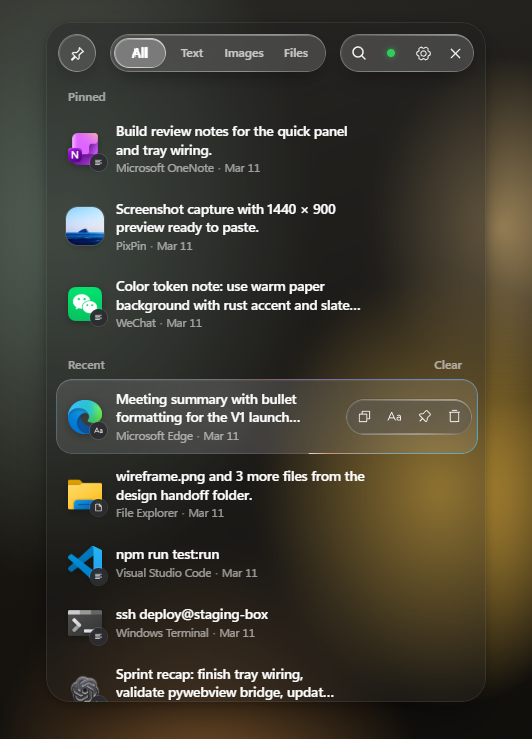

[English](README.en.md)

# CipherClip

Windows 剪贴板历史工具，液态玻璃界面。

**[在线 Demo](https://peteroooooooo.github.io/cipherclip/)** · **[下载](https://github.com/Peteroooooooo/cipherclip/releases/latest)**

<p align="center"></p>

## 使用

1. 下载 `CipherClip.zip`，解压后把 `CipherClip.exe` 放进一个固定文件夹，双击运行。
2. 按 `Alt + Space` 打开面板，选中一条记录按 `Enter`，就会粘贴回原来的输入框。

| 快捷键 | 作用 |
|---|---|
| `Alt + Space` | 打开面板 |
| `Enter` | 粘贴 |
| `Ctrl + Shift + V` | 纯文本粘贴 |
| `Ctrl + P` | 固定 / 取消固定 |
| `Delete` | 删除 |

历史保存在 exe 旁边的 `data` 文件夹，升级时只替换 exe。需要 WebView2 Runtime（Windows 11 自带）。

## 开发

```powershell
python -m venv .venv
.\.venv\Scripts\python -m pip install -r backend\requirements.txt
cd frontend; npm install; npm run build; cd ..
.\.venv\Scripts\python backend\main.py
```

打包：`.\scripts\build-release.ps1`，输出 `dist\CipherClip.exe`。
